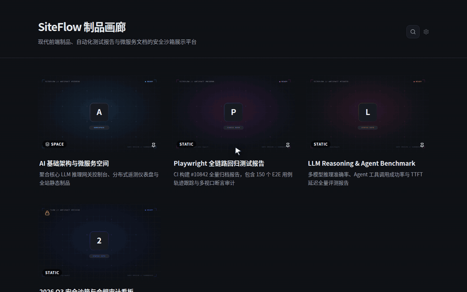

<div align="center">

# SiteFlow

Self-hosted sandboxed gallery & headless deployment portal for HTML reports, static sites, and AI artifacts.

[](https://github.com/mcocdaa)
[](https://github.com/mcocdaa/SiteFlow/actions/workflows/ci.yml)
[](https://github.com/mcocdaa/SiteFlow/releases)
[](https://www.python.org/)
[](Dockerfile)
[](LICENSE)

[English](README.md) · [简体中文](README_CN.md)



</div>

## ✨ Highlights

- **Human via UI, AI via API**: One-command headless `PUT /api/admin/projects/{slug}/deploy` endpoint for AI agents and CI/CD pipelines alongside a full drag-and-drop Admin Console for humans.
- **Zero-Trust Sandbox & ZipBomb Defense**: Hosted projects render inside a strict opaque-origin CSP sandbox (`allow-scripts` isolated from admin session cookies), backed by a hardened ZIP extractor with 100:1 compression-ratio circuit breakers, inode caps, and CP437/GBK filename transcoding.
- **Multi-Tier Spaces & Custom Themes**: Organize HTML reports, static ZIP sites, external links, resumes, and CommonMark blogs into up to 3 levels of nested Spaces, each with customizable accent colors, typography (`Sans` / `Serif` / `Mono`), and card radii.
- **Responsive Viewport Modal & `Cmd+K` Palette**: Preview artifacts across desktop (`100%`), tablet (`768px`), and mobile (`375px`) viewports with orientation toggle, LAN QR code debugging, and instant `Cmd+K` / `Ctrl+K` global search.
- **Procedural Covers, Password Locks & Sparklines**: Deterministic geometric SVG/WebP cover generation per slug, Argon2id per-project password protection (`Path=/projects/{slug}/` scoped cookies), and privacy-first 7-day PV/UV SVG sparklines.
- **Single-Container Footprint**: FastAPI + SQLite WAL in a <60 MB memory footprint with ETag/304 static caching and wildcard `BASE_DOMAIN` subdomain routing.

## 🚀 Quick Start

**Option 1 — Docker Compose (Recommended)**

```bash
cp .env.example .env   # set ADMIN_PASSWORD
docker compose up -d --build
```

Open `http://127.0.0.1:8000` (Admin console: `/admin`).

**Option 2 — Local `uv` Run**

```bash
ADMIN_PASSWORD=dev COOKIE_SECURE=false uv run uvicorn app.main:app --port 8000
```

## 🤖 AI / Headless API Deployment

AI agents and CI jobs can publish or update single-file HTML reports and multi-file ZIP bundles idempotently using `SITEFLOW_API_TOKEN` (configured via `.env` or copied from `/admin`):

```bash
# Deploy or update a static HTML report or ZIP site
curl -X PUT http://127.0.0.1:8000/api/admin/projects/my-report/deploy \
  -H "Authorization: Bearer <SITEFLOW_API_TOKEN>" \
  -F "file=@./report.html" \
  -F "title=Eval Benchmark Report" \
  -F "description=Nightly automated run"

# List all deployed projects and metadata
curl -H "Authorization: Bearer <SITEFLOW_API_TOKEN>" \
  http://127.0.0.1:8000/api/admin/projects
```

## ⚙️ Configuration & Docs

See [DESIGN.md](DESIGN.md) for architecture & security internals, and [deploy/README.md](deploy/README.md) for zero-source server bootstrap.

<details>
<summary>Environment Variables & Nginx Reverse Proxy</summary>

### Environment Variables (`.env`)

| Variable | Default | Description |
|----------|---------|-------------|
| `ADMIN_PASSWORD` | *(Required)* | Admin console password; rotating invalidates active sessions |
| `SITEFLOW_API_TOKEN` | *(Derived)* | Optional explicit Bearer token for headless API deployments |
| `SITE_TITLE` | `SiteFlow` | Gallery header title |
| `SITE_DESCRIPTION` | Default tagline | Gallery subtitle |
| `MAX_UPLOAD_MB` | `100` | Maximum upload payload size (MB) |
| `MAX_EXTRACT_MB` | `500` | Maximum uncompressed archive size (MB) |
| `MAX_ZIP_ENTRIES` | `5000` | Maximum file entries per ZIP archive |
| `COOKIE_SECURE` | `true` | Keep `true` behind HTTPS; set `false` for local HTTP debugging |
| `BASE_DOMAIN` | `""` | Optional wildcard subdomain root (e.g., `demo.example.com`) |
| `DATA_DIR` | `/data` | Persistent directory for SQLite WAL DB, projects, and covers |
| `PROJECTS_SANDBOX` | `true` | Must remain `true` for same-origin opaque sandbox isolation |

### Nginx Reverse Proxy

```nginx
server {
    listen 443 ssl;
    server_name gallery.example.com;

    client_max_body_size 120m;   # >= MAX_UPLOAD_MB
    proxy_read_timeout 300s;

    location / {
        proxy_pass http://127.0.0.1:8000;
        proxy_set_header Host $host;
        proxy_set_header X-Forwarded-For $proxy_add_x_forwarded_for;
        proxy_set_header X-Forwarded-Proto $scheme;
    }
}
```

</details>
