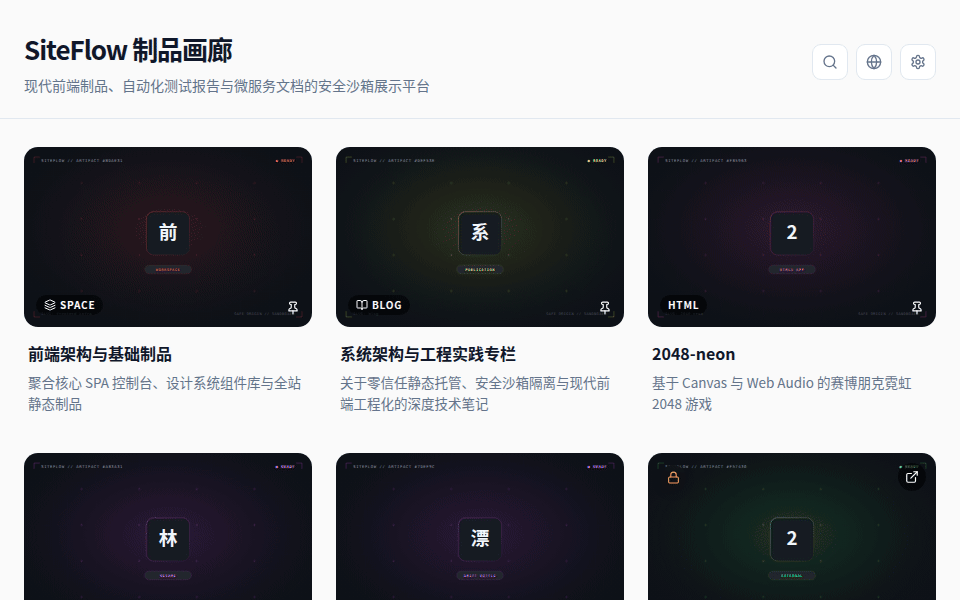

<div align="center">

# SiteFlow

Self-hosted sandboxed gallery, extensible page platform, and headless deployment portal for HTML reports, static sites, blogs, resumes, and AI artifacts.

[](https://github.com/mcocdaa)
[](https://github.com/mcocdaa/SiteFlow/actions/workflows/ci.yml)
[](https://github.com/mcocdaa/SiteFlow/releases)
[](https://www.python.org/)
[](Dockerfile)
[](https://github.com/mcocdaa/siteflow-plugins)
[](LICENSE)

[English](README.md) · [简体中文](README_CN.md)



</div>

## Highlights

- **Human via UI, AI via API**: Drag-and-drop Admin Console for humans alongside an Agent-Ready `/api/v1/*` REST API (authenticated OpenAPI self-discovery, scoped revocable DB tokens, idempotent blog publishing & image upload, structured content patching, and static HTML/ZIP `/deploy`).
- **PageSurface Extension Architecture & Layered Inheritance**: Decoupled `PageSurface` contract (`meta / context / slots / tokens / items / capabilities`) with three-tier inheritance (`Site Default → Parent Space → Child Space / Page`), three-state controls (`Inherit / Enable / Off`), one-click `Reset to Default`, parent-space cascade confirmation, secret-safe cross-layer inheritance, and `visitor / plugin / admin` privacy boundaries.
- **Zero-Build Declarative Plugin Pack Ecosystem**: Subscribe to GitHub plugin repositories (with one-click sync) or import offline ZIP packs—pure declarative CSS/JS/SVG with zero frontend build step and zero server-side code execution. Official pack: [`mcocdaa/siteflow-plugins`](https://github.com/mcocdaa/siteflow-plugins).
- **Rich Built-in Apps & Interactive Extensions**: Multi-tier Spaces (up to 3 levels, with Grid / Masonry / Polaroid / Draggable Desk layouts, background, banner, and live preview), GFM + offline KaTeX Blogs, auto-saving Resumes with Plugin Privacy Controls, moderated Drift Bottle Spaces, and Mascot v3 with streaming DeepSeek/OpenAI AI chat.
- **Hardened Zero-Trust Security**: Opaque-origin `CSP: sandbox` for hosted HTML/ZIP artifacts, ZipBomb defense, immediate gate-token invalidation on project password change, locked external links routed through the gate without leaking target URLs, and SSRF-protected outbound requests.
- **Unified Minimalist UI & Single-Container Footprint**: Pure monochrome SVG icon topbars (zero cartoon emojis), real-time `zh-CN / en-US` switching, dark/light themes, Top Layer (`popover="manual"`) toasts & anti-clipping hover tooltips, and FastAPI + SQLite WAL in a <60 MB footprint.

## PageSurface Architecture & Plugin Ecosystem

### Layered Inheritance & Privacy Boundaries

SiteFlow separates page types (`space`, `blog`, `resume`, `bottle`) from extensions through the [`PageSurface`](docs/PLUGIN_DESIGN.md) contract:

```text
Site Default (site_settings)  →  Parent Space (depth < 3)  →  Child Space / Page
```

- **Three-State Controls**: Each layer sets every applicable extension to **Inherit**, **Enable** (shallow-merged local override), or **Off**, with **Reset to Default** to return to inheritance. When no upstream layer enables an extension, `Inherit` is disabled with an explanatory hover tip. Enabling downward cascading (`cascade`) on a parent space prompts an explicit confirmation modal.
- **Secret-Safe Cross-Layer Inheritance**: Secret fields (such as AI API keys) are stored only at the layer that configures them, merged server-side for descendants, and never returned in plaintext to browsers or API clients.
- **Capability Matching & Privacy Audience**: Extensions declare capability requirements (`requires` / `excludes`) instead of hardcoding page types. Data providers filter `PageSurface.context(audience)` across `visitor`, `plugin` (with `ai` kept as a backward-compatible alias), and `admin`—for example, Resumes hide email, phone, and location from plugins and AI by default under **Plugin Privacy Controls**.

### Declarative Plugin Packs (`siteflow-plugins`)

In the Admin Console (`Plugin Sources`), subscribe to any compatible GitHub repository URL or upload an offline `.zip` pack:

- **Official Companion Repository**: [https://github.com/mcocdaa/siteflow-plugins](https://github.com/mcocdaa/siteflow-plugins)
  - `dafeiyu_theme`: DaFeiYu deep-sea theme pack using CSS variable `tokens`, `icon_overrides`, and `title_deco` slot decorations (enable at Site Default to theme the whole site while allowing individual spaces to opt out).
  - `reading_progress`, `code_copy_badge`, `space_welcome_badge`, and `resume_print_badge`.
- **Structured Extension Points**: Supports structured slots (`title_deco`, `header`, `aside`, `overlay`, `footer`), whitelisted CSS design `tokens` (`--accent`, `--radius-card`, `--font-family`, etc.), and validated local SVG `icon_overrides`.

## Built-in Apps & Extensions

| App / Extension | Key Capabilities |
|-----------------|------------------|
| **Multi-Tier Spaces (`space`)** | Up to 3 nested levels for HTML reports, static ZIP sites, links, and nested apps. Built-in **Space Layout** extension switches between **Standard Grid**, **Masonry**, **Polaroid**, and **Draggable Desk** (per-space browser-persisted positions with shuffle/reset and tilt controls), alongside **Space Background**, **Announcement Banner**, custom theme controls, and **real-time preview** inside the Admin drawer. |
| **Markdown + KaTeX Blog (`blog`)** | CommonMark + GFM tables, task lists, footnotes, auto TOC anchors, and **offline vendored KaTeX** math rendering (zero CDN). Dedicated per-post editor with unsaved-change guards, inline error retention, **Post Cover**, and **Post Background** extensions. |
| **Auto-Saving Resume (`resume`)** | JSON Resume subset with timeline rendering, print/PDF export, **debounced auto-save**, strict length validation (zero silent truncation), avatar preservation on partial updates, **Resume Style** extension with live preview, and **Plugin Privacy Controls**. |
| **Drift Bottle Space (`bottle`)** | Anonymous message beach powered by generic visitor submission moderation (`visitor_submissions` & `visitor_ip_bans`): **pre-moderation by default**, **throw-one-pick-one** signed visitor credits (excluding own bottles), **per-IP hourly rate limits**, **anti-obfuscation link blocking** + honeypot, and Admin moderation queue with approve/reject/delete, IP-hash ban/unban, and **one-click clear**. |
| **Mascot v3 (`mascot`)** | 7 pure-local vector characters (Starlight Cat, Shiba Inu, Whale, Twin Cat, Slime, Vocaloid, and **MIT-licensed DaFeiYu 4-pose SVG** `idle / thinking / speaking / tap`) + custom avatar upload (PNG/WebP/sanitized SVG), draggable dock, parameterized rotating tips, **DeepSeek (Anthropic protocol) & OpenAI-compatible streaming AI chat** (with collapsible thinking process and optional web search/URL read/safety check on DeepSeek), **page-type-aware default prompts** (general, resume-specialized, and per-layer custom override), and privacy-isolated resume context via `PageSurface`. |
| **Preview, Search & Analytics** | Multi-viewport preview modal (desktop `100%` / tablet `768px` / mobile `375px` + orientation toggle + LAN QR code), `Cmd+K` / `Ctrl+K` global search, deterministic procedural SVG covers, ETag/304 caching, `BASE_DOMAIN` wildcard subdomain routing, and privacy-first persistent UTC daily PV/UV SVG sparklines. |

## Security Guardrails

1. **Strict Sandbox & Template CSP**: Hosted `/projects/*` static HTML/ZIP files always serve with opaque-origin `CSP: sandbox` (`PROJECTS_SANDBOX=false` refuses startup); Blog and Drift Bottle templates enforce dedicated strict CSPs, and all template-rendered content stays Jinja auto-escaped.
2. **Hardened ZIP & SVG Processing**: Rejects path traversal (`..`), absolute paths, symlinks, encrypted entries, inode/size overflows, and 100:1 ZipBomb expansion ratios (with CP437/GBK filename transcoding). Uploaded SVGs and plugin pack SVGs undergo strict sanitization.
3. **Password Rotation Invalidation**: Changing `ADMIN_PASSWORD` immediately invalidates existing admin sessions (`password_version`); changing a project's password immediately invalidates existing unlock cookies via HMAC `project_password_version` across views, mascot chat, and bottle APIs.
4. **Locked External Link Gate**: Password-protected external links expose only `/projects/{slug}/` in gallery cards and `/api/search` for visitors, redirecting (`302` with `Cache-Control: no-store`) only after gate verification so the target URL never leaks.
5. **Safe Headless Redeploy & Outbound SSRF Defense**: Updating an existing project via `/deploy` without specifying `visible` preserves its current visibility (new projects default to visible). All platform outbound fetches (`app/og.py`), plugin pack syncs, and LLM API URLs enforce public-host/private-IP checks, timeouts, and size/redirect caps.
6. **Visitor Submission Hardening**: Public submission routes (such as Drift Bottle) enforce same-origin validation, default pre-moderation, link/obfuscation blocking, IP-hash rate limiting, and IP ban lists.
7. **Scoped Revocable API Tokens & `/api/v1/*` Isolation**: Database API tokens (`sft_...`) store only SHA-256 hashes and prefixes with one-time plaintext display, support least-privilege scopes, project-tree scoping with escape prevention, and instant revocation; non-admin tokens are denied on `/api/admin/*`, and `/api/v1/*` enforces `Cache-Control: no-store` with authenticated OpenAPI discovery.

## Quick Start

**Option 1 — Docker Compose (Recommended)**

```bash
cp .env.example .env   # set ADMIN_PASSWORD
docker compose up -d --build
```

Open `http://127.0.0.1:8000` (Admin Console: `/admin`).

**Option 2 — Local `uv` Development**

```bash
uv sync --frozen --extra dev
ADMIN_PASSWORD=dev DATA_DIR=./data COOKIE_SECURE=false \
  uv run uvicorn app.main:app --reload --port 8000
```

**Run the full local quality gate before submitting changes:**

```bash
./scripts/check.sh
```

## Headless API Deployment

AI agents and CI jobs can idempotently publish or update single-file HTML reports and multi-file ZIP sites using `SITEFLOW_API_TOKEN` (set explicitly in `.env` or derived automatically from `ADMIN_PASSWORD` / `SECRET_KEY`):

```bash
# Deploy or update a static HTML report or ZIP site
# Omitting "visible" on updates preserves the existing visibility state
curl -X PUT http://127.0.0.1:8000/api/admin/projects/my-report/deploy \
  -H "Authorization: Bearer <SITEFLOW_API_TOKEN>" \
  -F "file=@./report.html" \
  -F "title=Eval Benchmark Report" \
  -F "description=Nightly automated run"

# List all deployed projects and metadata
curl -H "Authorization: Bearer <SITEFLOW_API_TOKEN>" \
  http://127.0.0.1:8000/api/admin/projects
```

### Agent-Ready API v1 & Scoped Revocable Tokens

For AI agents and fine-grained automation, issue least-privilege revocable tokens (`sft_...`) with explicit scopes (`read`, `posts:write`, `content:write`, `projects:write`, `deploy:write`, `submissions:write`, `extensions:write`, `admin`), optional project/space scoping, and expiration directly from the Admin Console (**API Tokens** button in the topbar) or `POST /api/v1/tokens`:

```bash
# Discover token identity & authenticated OpenAPI 3.1 schema
curl -H "Authorization: Bearer <sft_token>" http://127.0.0.1:8000/api/v1/whoami
curl -H "Authorization: Bearer <sft_token>" http://127.0.0.1:8000/api/v1/openapi.json

# Idempotently publish or update a blog post
curl -X PUT http://127.0.0.1:8000/api/v1/blogs/my-blog/posts/release-notes \
  -H "Authorization: Bearer <sft_token>" \
  -H "Content-Type: application/json" \
  -d '{"title":"Release Notes","tags":["release"],"body":"## Summary\n\nShipped API v1."}'
```

See [docs/API_V1.md](docs/API_V1.md) for the complete endpoint reference, scope matrix, and `curl` recipes.

## Configuration & Docs

| Document | Description |
|----------|-------------|
| [docs/index.md](docs/index.md) | Documentation directory & entry hub |
| [docs/API_V1.md](docs/API_V1.md) | Agent-Ready `/api/v1/*` API guide, scope matrix & `curl` examples |
| [docs/PLUGIN_DESIGN.md](docs/PLUGIN_DESIGN.md) | Implemented `PageSurface` contract, layered inheritance & submission architecture |
| [DESIGN.md](DESIGN.md) · [DESIGN-v2.md](DESIGN-v2.md) | v1/v2 product architecture & security boundaries |
| [docs/deployment.md](docs/deployment.md) · [deploy/README.md](deploy/README.md) | Docker deployment, reverse proxy, HTTPS & zero-source server bootstrap |
| [docs/operations.md](docs/operations.md) | Backup, upgrade & troubleshooting runbook |
| [CHANGELOG.md](CHANGELOG.md) | Release history (Keep a Changelog) |
| [CONTRIBUTING.md](CONTRIBUTING.md) · [AGENTS.md](AGENTS.md) | Contribution workflow, Git/CI standards, codebase map & security red lines |
| [SECURITY.md](SECURITY.md) | Private vulnerability reporting policy |
| [`mcocdaa/siteflow-plugins`](https://github.com/mcocdaa/siteflow-plugins) | Official declarative plugin pack repository (themes, widgets & badges) |

<details>
<summary>Environment Variables & Nginx Reverse Proxy</summary>

### Environment Variables (`.env`)

| Variable | Default | Description |
|----------|---------|-------------|
| `ADMIN_PASSWORD` | *(Required)* | Admin console password; rotating invalidates active admin sessions |
| `SITEFLOW_API_TOKEN` | *(Derived)* | Optional explicit Bearer token for headless API deployments |
| `SECRET_KEY` | *(Auto-generated)* | Optional signing secret; defaults to persistent `DATA_DIR/secret_key` |
| `SITE_TITLE` | `SiteFlow` | Gallery header title |
| `SITE_DESCRIPTION` | Default tagline | Gallery subtitle |
| `MAX_UPLOAD_MB` | `100` | Maximum upload payload size (MB) |
| `MAX_EXTRACT_MB` | `500` | Maximum uncompressed archive size (MB) |
| `MAX_ZIP_ENTRIES` | `5000` | Maximum file entries per ZIP archive |
| `COOKIE_SECURE` | `true` | Keep `true` behind HTTPS; set `false` for local HTTP debugging |
| `BASE_DOMAIN` | `""` | Optional wildcard subdomain root (e.g., `demo.example.com`) |
| `DATA_DIR` | `/data` | Persistent directory for SQLite WAL DB, projects, covers & plugin packs |
| `PROJECTS_SANDBOX` | `true` | Must remain `true` for same-origin opaque sandbox isolation |

### Nginx Reverse Proxy

```nginx
server {
    listen 443 ssl;
    server_name gallery.example.com;

    client_max_body_size 120m;   # >= MAX_UPLOAD_MB
    proxy_read_timeout 300s;

    location / {
        proxy_pass http://127.0.0.1:8000;
        proxy_set_header Host $host;
        proxy_set_header X-Forwarded-For $proxy_add_x_forwarded_for;
        proxy_set_header X-Forwarded-Proto $scheme;
    }
}
```

</details>

## License

Released under the [MIT License](LICENSE).
