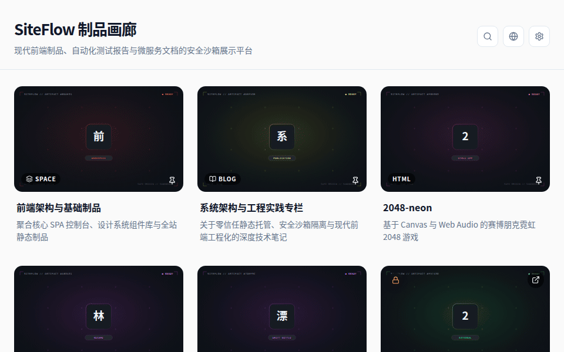

<div align="center">

# SiteFlow

面向 HTML 报告、静态站点、博客、简历与 AI 评测制品的轻量级安全沙箱画廊、可扩展页面平台与无头部署门户。

[](https://github.com/mcocdaa)
[](https://github.com/mcocdaa/SiteFlow/actions/workflows/ci.yml)
[](https://github.com/mcocdaa/SiteFlow/releases)
[](https://www.python.org/)
[](Dockerfile)
[](https://github.com/mcocdaa/siteflow-plugins)
[](LICENSE)

[English](README.md) · [简体中文](README_CN.md)



</div>

## 核心特性

- **Human via UI, AI via API**：既为人类提供直观的拖拽管理后台，又为 AI Agent 与 CI/CD 流水线提供幂等的 `PUT /api/admin/projects/{slug}/deploy` 一键无头发布接口。
- **PageSurface 统一扩展架构与分层继承**：通过 `PageSurface` 契约（`meta / context / slots / tokens / items / capabilities`）解耦页面与扩展，支持 `全站默认 → 父空间 → 子空间/页面` 三层继承、三态开关（`继承 / 启用 / 关闭` + `恢复默认` + 母空间级联确认）、密钥跨层安全继承不泄明文，以及 `visitor / plugin / admin` 隐私边界。
- **零构建声明式插件包生态**：支持 GitHub 仓库 URL 订阅（一键同步）与离线 ZIP 导入，纯静态声明式 CSS/JS/SVG，无前端构建步骤、无服务端远程代码执行。官方插件包仓库：[`mcocdaa/siteflow-plugins`](https://github.com/mcocdaa/siteflow-plugins)。
- **内置应用与扩展全景**：多级嵌套空间（最多 3 层，支持标准网格 / 瀑布流 / 拍立得 / 可自由拖拽持久化位置的拼贴桌面 + 背景/公告栏 + 实时预览）、GFM + 离线 KaTeX 数学公式博客、自动保存的简历编辑器与插件隐私控制、先审后发的漂流瓶空间，以及支持 DeepSeek/OpenAI 流式 AI 对话的看板娘 v3。
- **零信任安全红线与强化**：同域不透明源 `CSP: sandbox`、ZipBomb 膨胀率熔断、作品改密后门禁凭证立即失效、加锁外链走门禁跳转不泄真实 URL、重部署保留 `visible` 状态，以及全链路 SSRF 防护。
- **极简统一界面与轻量单容器**：全站统一纯 SVG 单色极简顶栏（零卡通 Emoji）、实时 `中文 / EN` 双语与深浅色切换、顶层 `popover="manual"` Toast 与防裁切悬浮提示；FastAPI + SQLite WAL 常驻内存 < 60MB。

## PageSurface 扩展架构与插件生态

### 分层继承与隐私边界

SiteFlow 通过 [`PageSurface`](docs/PLUGIN_DESIGN.md) 契约将页面类型（`space` / `blog` / `resume` / `bottle`）与扩展插件彻底解耦：

```text
全站默认 (site_settings)  →  父空间 (嵌套深度 < 3)  →  子空间 / 页面
```

- **三态模式与级联确认**：每一层对每个适用插件均支持 **继承 / 启用 / 关闭** 三态控制，并可一键 **恢复默认** 回到继承态；当上游均未启用时，`继承` 按钮自动置灰（保留悬浮说明气泡）；在母空间开启「向下级子项继承（`cascade`）」前弹出确认框，防止误操作扩散。
- **密钥跨层安全继承**：敏感字段（如 AI API Key）仅在配置它的层级持久化，子层继承时由服务端自动合并，绝不向浏览器或管理接口下发明文密钥（前端仅展示已设置/继承状态）。
- **能力位匹配与隐私边界**：插件按页面能力位（`requires` / `excludes`）声明适用范围而非写死页面类型。页面按 `visitor / plugin / admin`（`ai` 作为 `plugin` 的向后兼容别名）过滤上下文——例如简历页内置 **插件隐私控制**，默认向插件与 AI 隐藏邮箱、电话与所在地，并支持按板块细粒度开关。

### 声明式插件包（`siteflow-plugins`）

在管理后台「插件订阅源」中可直接填写 GitHub 仓库地址订阅，或导入离线 `.zip` 插件包：

- **官方配套插件包仓库**：[https://github.com/mcocdaa/siteflow-plugins](https://github.com/mcocdaa/siteflow-plugins)
  - `dafeiyu_theme`（大肥鱼深海主题包）：基于结构化插槽 `title_deco`、CSS 变量 `tokens` 与 `icon_overrides` 定制全站视觉与图标；在全站默认层启用即可全局生效，个别子空间可随时独立关闭。
  - 同时内置 `reading_progress`（阅读进度条）、`code_copy_badge`（代码块一键复制）、`space_welcome_badge`（空间状态徽章栏）与 `resume_print_badge`（简历求职状态条）。
- **结构化插槽与白名单变量**：支持 `title_deco` / `header` / `aside` / `overlay` / `footer` 插槽、白名单 CSS 设计 `tokens`（`--accent`、`--radius-card`、`--font-family` 等）以及经校验的本地 SVG `icon_overrides`。

## 内置应用与扩展全景

| 应用 / 扩展 | 核心能力 |
|-------------|----------|
| **多级嵌套空间（`space`）** | 最多 3 层空间嵌套，容纳单 HTML、ZIP 静态站点、外链与子应用。内置 **空间排布模式** 插件支持 **标准网格 / 瀑布流 / 拍立得 / 可自由拖拽的拼贴桌面**（浏览器按空间持久化卡片位置，支持打乱、归位与倾角强度调节），搭配 **空间背景**、**公告栏**、个性化主题与管理抽屉 **实时预览**。 |
| **富文本 Markdown + KaTeX 博客（`blog`）** | 支持 CommonMark + GFM 表格、任务列表、脚注、目录锚点与 **离线内置 KaTeX** 数学公式渲染（零 CDN）。提供每篇文章独立沉浸式编辑页、未保存离开提醒、保存失败行内保错，以及 **文章封面**、**文章背景** 扩展。 |
| **在线简历与样式美化（`resume`）** | JSON Resume 子集时间线排版与打印/PDF 导出；管理端支持 **防抖自动保存**、严格字数/条数校验（零静默截断）、局部更新保留已有头像、**简历样式** 实时预览以及 **插件隐私控制**。 |
| **漂流瓶空间（`bottle`）** | 基于通用访客提交审核基础设施（`visitor_submissions` 与 `visitor_ip_bans`）构建：默认 **先审后发**、签名 Cookie 驱动的 **投一捞一**（自动排除本人投递）、**按 IP 哈希每小时限频**、**防混淆禁链接** 与蜜罐防刷；管理台支持待审/通过/拒绝审核、IP 封禁解封与 **一键清空**。 |
| **看板娘 v3（`mascot`）** | 内置 7 套纯本地矢量角色（星光小猫、元气柴犬、深蓝小鲸鱼、星尘双子猫、水滴史莱姆、银发歌姬，以及 **MIT 开源大肥鱼四姿态 SVG** `idle / thinking / speaking / tap`）+ 自定义头像上传（PNG/WebP/净化 SVG），支持自由拖拽、变量化轮播提示语、**DeepSeek（Anthropic 协议）与 OpenAI 兼容流式 AI 对话**（含可折叠深度思考、DeepSeek 联网搜索/网页阅读/安全审查），**三层默认提示词体系**（通用默认 / 简历专用默认 / 本层自定义覆盖）以及基于 `PageSurface` 的简历上下文隐私隔离。 |
| **视口预览、检索与统计** | 多视口响应式安全预览弹窗（桌面 `100%` / 平板 `768px` / 手机 `375px` + 横竖屏切换 + 局域网真机二维码）、`Cmd+K` / `Ctrl+K` 全局检索、按 Slug 生成的过程式矢量封面、ETag/304 协商缓存、`BASE_DOMAIN` 泛解析子域名路由与持久化 UTC 7 日 PV/UV SVG 趋势折线。 |

## 安全红线与强化

1. **沙箱与模板 CSP 隔离**：`/projects/*` 静态 HTML/ZIP 始终下发不透明源 `CSP: sandbox`（`PROJECTS_SANDBOX=false` 时拒绝启动）；博客与漂流瓶模板具备独立严格 CSP，全部用户内容保持 Jinja 自动转义。
2. **ZIP 与 SVG 安全防线**：作品上传与离线插件包解压均拒绝 `..` 路径穿越、绝对路径、符号链接、加密条目、超量条目、超限解压与 100:1 压缩比炸弹，并兼容 Windows CP437/GBK 中文文件名无损转码；上传及插件包内的 SVG 强制执行安全净化。
3. **改密立即失效机制**：修改 `ADMIN_PASSWORD` 后旧管理会话立即失效（`password_version`）；修改单作品访问密码后，旧门禁凭证立即失效（基于 HMAC `project_password_version`，同时覆盖页面访问、看板娘对话与漂流瓶接口）。
4. **加锁外链走门禁跳转**：带密码保护的外链在非管理员画廊卡片与 `/api/search` 中仅暴露 `/projects/{slug}/`，验证密码后返回 `302`（带 `Cache-Control: no-store`），绝不提前泄露真实目标 URL。
5. **安全重部署与外呼 SSRF 防护**：通过 `/deploy` 更新已有项目时若省略 `visible` 字段会保留原可见性（新建默认可见）；OG/封面抓取（`app/og.py`）、插件包 GitHub 同步与 AI 接口地址均执行公网主机/私网 IP 校验、超时与体积/重定向上限限制。
6. **访客提交端点防刷与审核**：漂流瓶等公开提交接口强制执行同源校验、先审后发、服务端防混淆禁链、IP 哈希限频与封禁列表拦截。

## 快速开始

**方式 1 — Docker Compose（推荐）**

```bash
cp .env.example .env   # 设置管理员密码 ADMIN_PASSWORD
docker compose up -d --build
```

打开 `http://127.0.0.1:8000`（管理后台：`/admin`）。

**方式 2 — 本地 `uv` 开发启动**

```bash
uv sync --frozen --extra dev
ADMIN_PASSWORD=dev DATA_DIR=./data COOKIE_SECURE=false \
  uv run uvicorn app.main:app --reload --port 8000
```

**提交前运行一键质量门禁：**

```bash
./scripts/check.sh
```

## AI / 无头 API 部署

AI Agent 或 CI 流水线可通过 `SITEFLOW_API_TOKEN`（可在 `.env` 中显式配置，或由系统基于 `ADMIN_PASSWORD` / `SECRET_KEY` 自动派生）幂等地发布或更新单文件 HTML 报告与多文件 ZIP 站点：

```bash
# 一键部署或更新静态 HTML 报告 / ZIP 站点
# 更新已有项目时省略 visible 将保留其原有的显示/隐藏状态
curl -X PUT http://127.0.0.1:8000/api/admin/projects/my-report/deploy \
  -H "Authorization: Bearer <SITEFLOW_API_TOKEN>" \
  -F "file=@./report.html" \
  -F "title=Eval Benchmark Report" \
  -F "description=Nightly automated run"

# 查询已部署项目列表与元数据
curl -H "Authorization: Bearer <SITEFLOW_API_TOKEN>" \
  http://127.0.0.1:8000/api/admin/projects
```

## 配置与文档导航

| 文档 | 内容说明 |
|------|----------|
| [docs/index.md](docs/index.md) | 完整文档总索引 |
| [docs/PLUGIN_DESIGN.md](docs/PLUGIN_DESIGN.md) | 已落地的 `PageSurface` 插件契约、分层继承与访客提交架构 |
| [DESIGN.md](DESIGN.md) · [DESIGN-v2.md](DESIGN-v2.md) | v1/v2 产品架构与安全边界设计 |
| [docs/deployment.md](docs/deployment.md) · [deploy/README.md](deploy/README.md) | Docker 部署、反向代理、HTTPS 与免源码服务器一键部署 |
| [docs/operations.md](docs/operations.md) | 数据备份、升级与排障手册 |
| [CHANGELOG.md](CHANGELOG.md) | 版本变更日志（Keep a Changelog） |
| [CONTRIBUTING.md](CONTRIBUTING.md) · [AGENTS.md](AGENTS.md) | 贡献流程、Git/CI 规范、代码目录职责与安全红线 |
| [SECURITY.md](SECURITY.md) | 私密安全漏洞上报策略 |
| [`mcocdaa/siteflow-plugins`](https://github.com/mcocdaa/siteflow-plugins) | 官方声明式插件包仓库（大肥鱼主题包与官方小部件） |

<details>
<summary>环境变量与 Nginx 反向代理配置</summary>

### 环境变量（`.env`）

| 变量 | 默认值 | 说明 |
|------|--------|------|
| `ADMIN_PASSWORD` | *（必填）* | 管理员密码；修改并重启后旧管理会话全部失效 |
| `SITEFLOW_API_TOKEN` | *（自动派生）* | 可选显式指定无头部署 API 的 Bearer Token |
| `SECRET_KEY` | *（自动生成）* | 可选会话签名密钥；默认自动持久化于 `DATA_DIR/secret_key` |
| `SITE_TITLE` | `SiteFlow` | 画廊站点标题 |
| `SITE_DESCRIPTION` | 默认副标题 | 画廊副标题描述 |
| `MAX_UPLOAD_MB` | `100` | 单次上传文件大小上限 (MB) |
| `MAX_EXTRACT_MB` | `500` | 解压后总大小上限 (MB) |
| `MAX_ZIP_ENTRIES` | `5000` | 单个压缩包最大文件条目数 |
| `COOKIE_SECURE` | `true` | HTTPS 部署保持 `true`；纯本机 HTTP 调试可设 `false` |
| `BASE_DOMAIN` | `""` | 可选泛解析子域名根域（如 `demo.example.com`） |
| `DATA_DIR` | `/data` | 数据持久化目录（SQLite WAL、作品文件、封面与插件包） |
| `PROJECTS_SANDBOX` | `true` | 禁止关闭；同域部署必须保持不透明沙箱隔离 |

### Nginx 反向代理

```nginx
server {
    listen 443 ssl;
    server_name gallery.example.com;

    client_max_body_size 120m;   # 需大于 MAX_UPLOAD_MB
    proxy_read_timeout 300s;

    location / {
        proxy_pass http://127.0.0.1:8000;
        proxy_set_header Host $host;
        proxy_set_header X-Forwarded-For $proxy_add_x_forwarded_for;
        proxy_set_header X-Forwarded-Proto $scheme;
    }
}
```

</details>

## 开源协议

本项目基于 [MIT License](LICENSE) 开源。
